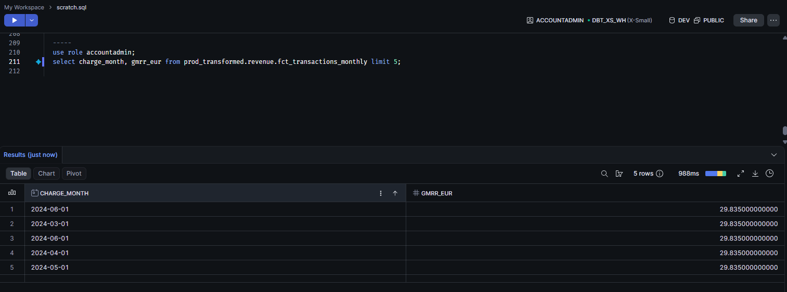
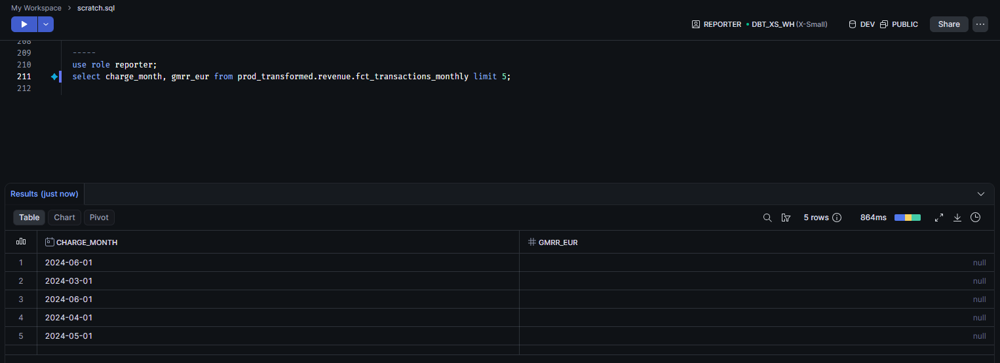
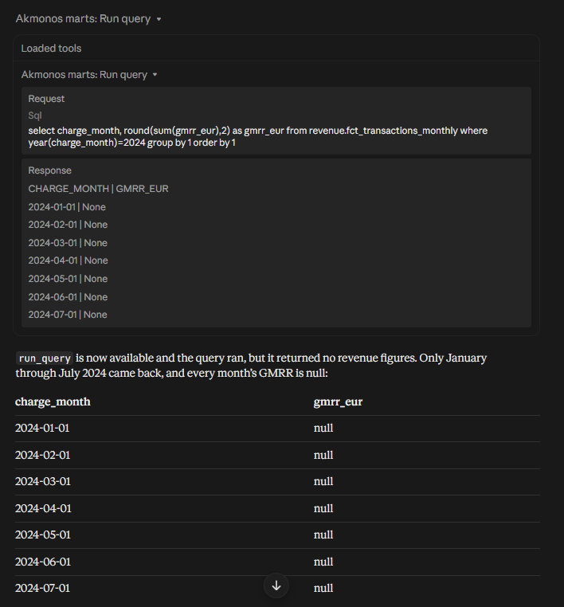
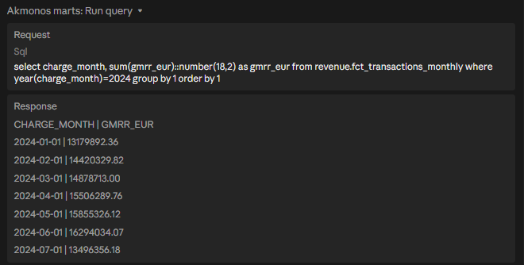

# Akmonos dbt

Akmonos is a dbt and Snowflake data platform built to serve governed, AI-ready data marts. This repository holds the SQL logic, tests, metrics, and metadata for the platform. Changes merge through CI and deploy to production through GitHub Actions, behind a manual approval gate.

The first mart in production is `revenue_star_emea`: a Kimball star schema over an anonymized EMEA subscription revenue dataset. Privacy is designed in from the first step: data is anonymized before it ever reaches the cloud, and sensitive columns are classified in metadata for masking in Snowflake.

## Architecture

Data flows through four layers, each a folder under `models/`:

| Layer | Folder | Materialization | Purpose |
|---|---|---|---|
| Anonymize | `models/anonymize/` | table (Postgres only) | Strips PII and brand identifiers from source extracts before anything leaves the local environment. Enabled only on the `anonymize` target; never built in Snowflake. |
| Staging | `models/staging/` | view | One model per source table. Renaming, typing, light cleanup. |
| Intermediate | `models/intermediate/` | table | Business logic: surrogate keys, multi-currency conversion. |
| Marts | `models/marts/` | table | Dimensional models served to BI and AI consumers. |

Source data is anonymized locally in Postgres, landed in S3, and loaded into Snowflake `PROD_RAW`. All dbt models read from `PROD_RAW` and build into the environment they target. On top of the marts, a semantic layer defines the business metrics once (see [Semantic layer](#semantic-layer)).

### Environments

One codebase, three destinations, controlled by the target and a custom `generate_schema_name` macro:

| Environment | Database | Schema pattern | Built by |
|---|---|---|---|
| Development | `DEV` | `DBT_<USERNAME>_<LAYER>` | Each developer, locally |
| CI | `DEV` | `CI_<LAYER>` | GitHub Actions, on every pull request |
| Production | `PROD_TRANSFORMED` | clean layer names | GitHub Actions, on merge to `main`, after approval |

Developers never write to production. Code travels through the pipeline; data is rebuilt in each environment from `PROD_RAW`.

## Data marts

### revenue_star_emea

A star schema covering monthly subscription revenue across the EMEA region.

| Schema | Models |
|---|---|
| `SHARED_REF` | `dim_dates`, `dim_currencies`, `dim_regions` |
| `REVENUE` | `dim_partners`, `dim_vendors`, `dim_cams`, `dim_products`, `fct_transactions_monthly` |

Shared reference dimensions live in `SHARED_REF` so future marts can conform to them. The fact table carries gross and net MRR converted into EUR, GBP, and USD at the row level. Output totals are reconciled to the cent against the source dataset, verifying the pipeline loses and distorts nothing.

Further marts will be added here as the platform grows.

## Semantic layer

Business metrics are defined once, in yml, with [MetricFlow](https://docs.getdbt.com/docs/build/about-metricflow) (the dbt Semantic Layer). Every consumer, whether a dashboard, the MCP server, or an analyst at the command line, gets the same number from the same definition, with no SQL to rewrite.

The semantic model lives inside each model's existing yml using the latest dbt spec: entities on the keys, dimensions on the columns worth slicing by, and simple metrics on the fact. `dim_dates` is configured as the time spine, so any metric can be grouped by day, week, month, quarter, or year.

| Metric | Type | Definition |
|---|---|---|
| `total_gmrr_eur`, `total_gmrr_gbp`, `total_gmrr_usd` | simple | Gross monthly recurring revenue, summed in each currency |
| `total_nmrr_eur`, `total_nmrr_gbp`, `total_nmrr_usd` | simple | Net monthly recurring revenue, summed in each currency |
| `vendors_per_partner` | ratio | VPP: average number of distinct vendors each partner buys from |

Every metric can be sliced by any dimension reachable through the star schema, for example partner sales region, vendor, account manager, or currency:

```
mf validate-configs
mf query --metrics total_gmrr_eur --group-by metric_time__year --order metric_time__year
mf query --metrics total_gmrr_eur --group-by partner__partner_sales_region
mf query --metrics vendors_per_partner --group-by metric_time__quarter
```

The grand-total GMRR returned by MetricFlow reconciles to the cent with the mart tie-out above.

## Installation

1. Install Python 3 and create a virtual environment:

   ```powershell
   # Windows PowerShell
   python -m venv ..\dbt_venv
   ..\dbt_venv\Scripts\activate
   pip install dbt-core dbt-snowflake dbt-postgres "dbt-metricflow[dbt-snowflake]" sqlfluff sqlfluff-templater-dbt pre-commit
   ```

2. Verify with `dbt --version` and `mf --version`, then install package dependencies:

   ```
   dbt deps
   ```

3. Create `~/.dbt/profiles.yml`. Snowflake sign-in uses key-pair authentication, so no password is stored anywhere. The private key stays on your machine and is never committed (`*.p8` is gitignored):

   ```yaml
   dbt_akmonos:
     target: dev
     outputs:
       dev:
         type: snowflake
         account: "{{ env_var('SNOWFLAKE_ACCOUNT') }}"
         user: "{{ env_var('SNOWFLAKE_USER') }}"
         private_key_path: "<path to your rsa_key.p8>"
         role: <role>
         warehouse: dbt_xs_wh
         database: dev
         schema: dbt_<username>
         threads: 4
   ```

4. Set `SNOWFLAKE_ACCOUNT`, `SNOWFLAKE_USER`, and `DBT_PROFILES_DIR` (the folder holding `profiles.yml`, which MetricFlow needs) as user environment variables, restart your terminal, and confirm the connection:

   ```
   dbt debug
   ```

5. Turn on the pre-commit hooks, so every commit is checked before it is created:

   ```
   pre-commit install
   ```

## Development workflow

1. Branch from an up-to-date `main`:

   ```
   git checkout main
   git pull
   git checkout -b <branch-name>
   ```

2. Develop and build locally. Everything you build lands in your own `DBT_<USERNAME>_*` schemas in `DEV`:

   ```
   dbt build -s <selection>
   ```

3. Commit. Pre-commit runs SQLFluff and the file checks on everything you changed. If a hook fixes a file, the commit stops so you can review the fix; stage it with `git add` and commit again.

4. Push the branch and open a pull request. The pull request template lists the validation steps. CI compares the branch against the latest production manifest and builds only modified models and everything downstream of them, into isolated `CI_*` schemas, deferring unchanged models to production. `main` is protected: a pull request, a passing CI check, and an approval are required before merge.

5. Merge to `main`. The deploy workflow pauses at the `production` environment until a reviewer approves it, then builds the project into `PROD_TRANSFORMED`. Only `main` can deploy to production.

GitHub Actions signs in to Snowflake as a dedicated service user with key-pair authentication. The key is held in repository secrets and injected into `ci/profiles.yml`; no password exists for this user.

## Testing and data quality

Tests are defined in each model's yml and run both locally and in CI as part of `dbt build`, so a model that fails its tests never reaches merge. Every model carries uniqueness and not-null tests on its key, and fact tables carry relationship tests against their dimensions. Semantic models and metrics are validated against the warehouse with `mf validate-configs`.

## Code quality

SQL style is enforced by [SQLFluff](https://sqlfluff.com/), configured in `.sqlfluff`. It uses the dbt templater, so each model is compiled through dbt into the exact SQL Snowflake runs before it is checked: real `ref()`, `source()`, and macro output, not a guess. The rules follow the dbt Labs style guide.

[pre-commit](https://pre-commit.com/) runs these checks on every commit, configured in `.pre-commit-config.yaml`:

| Hook | What it does |
|---|---|
| `sqlfluff-fix` | Rewrites SQL to the house style |
| `sqlfluff-lint` | Fails the commit on anything it can't fix automatically |
| `check-yaml` | Catches broken yml before dbt ever parses it |
| `detect-private-key` | Blocks any commit that contains a private key |
| `end-of-file-fixer` | Every file ends with a single newline |
| `trailing-whitespace` | Strips stray spaces at the end of lines |

`.sqlfluffignore` skips `target/`, `dbt_packages/`, `macros/`, and the Postgres-only `models/anonymize/` folder. To check the whole project by hand:

```
sqlfluff lint models
```

## Documentation

Every model has a yml file referencing shared doc blocks, so each description is written once and reused everywhere it applies:

- `_<folder>__docs.md` in each model folder holds the doc blocks for that layer.
- `dbt docs generate && dbt docs serve` builds and serves the documentation site locally.

Every deploy regenerates the dbt docs site and stores it as a build artifact. Publishing to GitHub Pages is on the roadmap.

## Conventions

- One yml file per model (`model.sql` + `model.yml` pairs); descriptions reference doc blocks rather than repeating text.
- Staging models: `stg_<source>__<entity>`. Intermediate: `int_<source>__<description>`. Marts: `dim_`/`fct_` prefixes.
- Sources are defined once per source system in a `_<source>__sources.yml` file.
- Every `ref()` and `source()` sits in an import CTE at the top of the model, so a model's inputs are visible at a glance.
- Every model ends by naming its output columns explicitly, never `select *`, so a model's output is visible in the code and an upstream column can't slip into a mart unnoticed.
- Lowercase SQL, four-space indents, trailing commas, and a newline at the end of every file, all enforced by SQLFluff.
- Settings shared by a whole folder live in `dbt_project.yml`; `config()` in a model is reserved for that model's exceptions.
- Semantic models and simple metrics live in the model's own yml; cross-model metrics (ratios, derived) live in a top-level `metrics:` block.

## Governance

Sensitive columns are classified in model yml under `meta.data_classification`, and commercially sensitive measures also carry a `meta.masking_policy` tag. On every build, a hook creates the masking policy in Snowflake and attaches it to every tagged column, so masking survives each rebuild and ships through the same CI/CD path as the models.

Access is role based, following the dbt Labs loader/transformer/reporter pattern:

| Role | Used by | Can do |
|---|---|---|
| `transformer` | dbt in CI and deploy | Read `PROD_RAW`, build and own the schemas in `DEV` and `PROD_TRANSFORMED`, create and attach masking policies. Nothing else. |
| `reporter` | BI tools and the MCP server | Read the marts. Masked columns return NULL. |

CI and deploy run as the least-privilege `transformer` role, not as an admin. If the pipeline's key were ever exposed, it could build tables and nothing more: no access to users, billing, or other databases.

Masking enforcement lives in Snowflake itself, so it applies to every client that queries the warehouse, including metrics queried through the semantic layer. PII never reaches the cloud at all: it is removed in the anonymize layer before load.

| ACCOUNTADMIN | REPORTER |
|---|---|
|  |  |

## AI access through MCP

The `mcp-server/` folder holds a Python MCP server that lets AI clients such as the Claude desktop app query the marts. It exposes three read-only tools:

| Tool | What it does |
|---|---|
| `list_tables` | Lists the mart tables with row counts |
| `describe_table` | Returns a table's columns, data types, and documentation |
| `run_query` | Runs a SELECT and returns up to 50 rows |

The server signs in to Snowflake with key-pair authentication, so no password is stored anywhere. It connects as the `reporter` role by default, so masking applies to the AI exactly as it does to any other client: revenue columns come back as NULL unless a privileged role is set on purpose.

| As REPORTER (default) | As ACCOUNTADMIN |
|---|---|
|  |  |

## Maintenance

Deleting or renaming a dbt model does not delete the old table in Snowflake; the leftover object stays behind. Today those leftovers are dropped by hand.

Planned: cleanup macros that find and drop them automatically, including stale developer schemas in `DEV`.

## Roadmap

- Publish the dbt docs site to GitHub Pages on every deploy
- Enforce the `arguments` property on generic tests ahead of the dbt v2 upgrade
- Evaluate the dbt v2 engine (SQLFluff compatibility, package support, CI changes)
- Streamlit dashboard over the marts and metrics
- Snowflake object tags generated from classification metadata
- Automated catalog and lineage with DataHub, ingested on every deploy
- Infrastructure as code with Terraform
- Cleanup macros for orphaned relations and developer schemas
- Snowflake Cortex Search over the marts
- Hosted MCP server over HTTP with authentication

## About

Built and maintained by Ibby Nosiru. Connect on [LinkedIn](https://www.linkedin.com/in/ibrahim-ibby-n-b6803577/).
